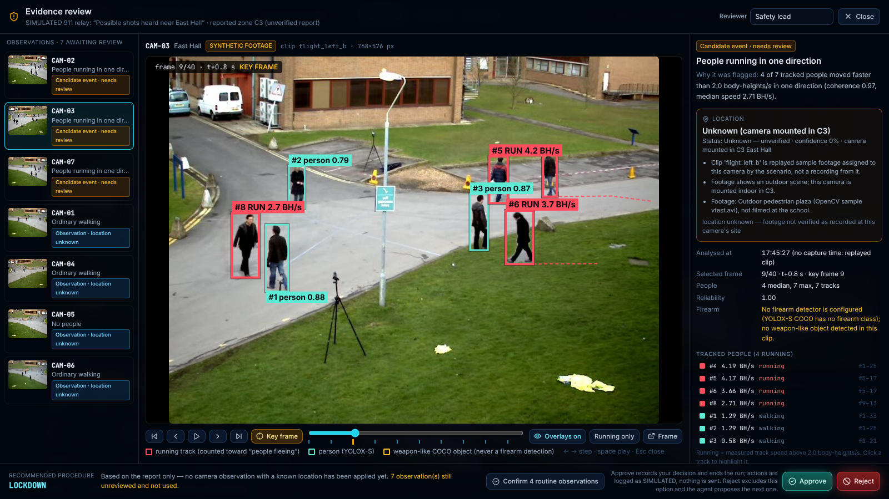

# CLEARPATH

**Agentic vision for school safety assessment.** An OpenCV 5 pipeline analyses camera footage, an agent maintains a
threat-location belief over a school digital twin, decides which camera to look at next, re-processes footage when the
image quality is poor, separates *mathematical route validity* from *operational safety*, evaluates predefined response
procedures and **always pauses for human review**. Built for the OpenCV AI Competition 2026 (powered by AWS); targets
the **Agentic Vision** award. COOL integration is prepared (swap point + benchmark harness) but was **not measured**, so
we do not claim the Best Use of COOL award.

> **SIMULATION ONLY.** Footage is synthetic (real pedestrians from OpenCV's public sample video, recomposited), triggers
> are simulated reports, and no code path can send a real alert, notification or door command.

> **No firearm detection.** YOLOX-S (COCO-80) has no firearm class and no weapon model is configured; "firearm" only
> appears in the simulated report text. Footage is not from any school camera, so observation locations are shown as
> **unknown** until a human reviewer confirms them.



**Team:** `[[TEAM NAME]]` — `[[members]]`

| Judge documents | |
|---|---|
| Technical report | [docs/technical-report.md](docs/technical-report.md) |
| Architecture | [docs/architecture.mmd](docs/architecture.mmd) ([PNG](docs/architecture.png)) · agent workflow [docs/diagrams/agent_workflow.png](docs/diagrams/agent_workflow.png) |
| Setup · Deployment · Testing | [docs/setup.md](docs/setup.md) · [docs/deployment.md](docs/deployment.md) · [docs/testing.md](docs/testing.md) |
| Evaluation (method, results, failure cases) | [evaluation/README.md](evaluation/README.md) |
| Demo video | `[[VIDEO URL (unlisted, ≤ 5 min)]]`. Local file: [docs/video/clearpath-demo.mp4](docs/video/clearpath-demo.mp4) (4:42). Script: [docs/demo-video-script.md](docs/demo-video-script.md) |
| Submission checklist | [docs/submission-checklist.md](docs/submission-checklist.md) |

## Live demo (for judges)

| | |
|---|---|
| **App** | `[[URL — redeploy and run deploy/aws/verify.sh first]]` |
| **Status** | The earlier deployment at `52.70.58.148` (`t4g.small`, us-east-1) was reported verified on 2026-10-26 for commit `a3e70d5`, which predates the location fix. The current code has **not** been redeployed or re-verified. |
| **Graviton proof** | `GET <URL>/v1/health` → `"machine": "aarch64"`, `"instance_type"` from IMDSv2 |

Suggested 3-minute tour:

1. The app opens on **Start**. Pick **S2 – corroborated incident** and press **Start analysis**.
2. When the agent pauses, open **Review evidence**. Each camera observation opens full-size on its key frame, with the
   tracked people that were measured running highlighted in red. Its location is **unknown**: the footage is OpenCV's
   outdoor sample video, not a recording from the school's cameras, so nothing is placed on the twin yet and the
   recommendation is a report-only **LOCKDOWN**.
3. **Confirm** the candidate events (you assert they happened at the camera's zone) or **Dismiss** them with a reason.
   After confirming CAM-02/03/07 the agent localises the east wing and recommends **LOCKDOWN → EVACUATE**; then
   **Approve** or **Reject** (actions are logged as `SIMULATED` only). Every decision appears in the trace.

> The system has **no firearm detector** (YOLOX-S COCO has no firearm class). Firearm claims come only from the
> simulated report; the footage contains no weapon.

Each camera analysis took about 10 s on the 2-vCPU `t4g.small` (reported), so a scenario takes about 1–1.5 minutes. The demo is a single
shared instance: starting a new scenario cancels the one in progress, so if a run is already going, wait for it.

## What it does

| Layer | Implementation |
|---|---|
| Computer vision (OpenCV 5.0.0) | Image-quality assessment (brightness, contrast, Laplacian sharpness, dark-channel haze, frozen-feed and lens-obstruction checks) → optional CLAHE / dark-channel dehaze → MOG2 background subtraction → Farneback dense optical flow → **YOLOX-S via `cv.dnn`** (OpenCV Model Zoo, Apache-2.0) → multi-object tracking → speed in body-heights/s, running fraction, direction coherence. Two independent motion estimates (tracks vs flow) are cross-checked. |
| Agent | Explicit state machine with tool contracts (`vision.analyze_camera`, `twin.validate_building`, `decision.compute_routes`, `decision.assess_options`, human review). Vision output changes the next tool call: camera selection by expected information, dehaze re-run on haze, denser re-run on inconsistent motion, persistence check on weapon-like objects, fault + coverage gap on frozen/obstructed feeds, stop criteria, recommendation and review request. |
| Digital twin | Fictional single-storey school (16 zones, 6 exits, 17 doors, 7 cameras). Shapely validates geometry (overlaps, doors on shared walls, exits on the exterior, cameras inside zones); NetworkX validates connectivity, ≥2 exits per occupied space, configured travel distance, single points of failure. |
| Decision support | Bayesian threat-location belief (zones + "no threat"), likelihoods tempered by measured camera reliability, a floor on "no threat". Procedures follow the Standard Response Protocol vocabulary (Hold, Secure, Lockdown, Evacuate, Shelter + hybrid Lockdown/targeted Evacuate) with explicit preconditions. A report alone can never localise a threat or trigger evacuation. |
| UI | React + TypeScript + Vite + Tailwind + React Three Fiber. Camera player with detection overlays, interactive 2D/3D twin, belief, options, routes (math vs operational columns), human-review controls, live agent trace. Everything is backend state. |
| AWS | Separate Vision Service designed for Graviton (arm64) EC2; S3 for footage/run archives; CloudWatch metrics with `Arch`/`OpenCV`/`COOL` dimensions; least-privilege instance role; no Docker. Kit in `deploy/aws/`. |
| COOL | Swappable OpenCV build, verified at runtime by a build-info marker (`/v1/health` → `cool.state`) and a reproducible stock-vs-COOL benchmark harness (`backend/benchmarks/`). **No COOL numbers are claimed until measured on Graviton.** |

## Results (measured; details in [evaluation/README.md](evaluation/README.md))

All on synthetic composites of OpenCV's public sample video, x86_64 2 vCPU, OpenCV 5.0.0, 2026-10-26.

* Activity classification: **15/15** clips (14 synthetic with generation ground truth + unmodified `vtest.avi`).
* Person detection (clean frames, IoU 0.5): P **0.970** / R **0.932** — optimistic, sprites were cut with the same detector.
* Running-track classification: P **0.967** / R **0.829**; false candidate events on non-flight clips: **0/10**.
* Location: **0/26** observations placed in a zone before human review (footage not registered to any camera).
* Human-review state invariants: **160/160**. Recommendations: before review 4/4 report-only LOCKDOWN; after
  confirming observation locations **4/4** expected; naive "evacuate on any weapon report" **0/4**.
* Tests: backend **90 passed**, frontend **77 passed**; type check and production build clean.
* Pending (not measured): real-footage accuracy, firearm detection, physical location accuracy, Graviton latency for
  the current code, COOL vs stock.


## Run locally

Requirements: Python **3.12 or 3.13**, Node 20+. Full guide: [docs/setup.md](docs/setup.md). Windows: `start.bat`.

```bash
# backend
cd backend
python -m venv .venv && source .venv/bin/activate        # Windows: .venv\Scripts\activate
pip install -r requirements.txt
python scripts/generate_footage.py                       # builds 14 synthetic clips (~30 s); downloads vtest.avi if missing
uvicorn clearpath.main:app --port 8000

# frontend (dev, hot reload; proxies /api and /media to :8000)
cd ../frontend
npm install
npm run dev                                              # http://localhost:5173
# or single-port: npm run build, then restart uvicorn and open http://localhost:8000
```

The YOLOX model (`backend/models/yolox_s_2022nov.onnx`, 36 MB) comes from the
[OpenCV Model Zoo](https://github.com/opencv/opencv_zoo/tree/main/models/object_detection_yolox).

Run the vision service separately (as on AWS):

```bash
uvicorn clearpath.vision.service:app --port 8100
VISION_MODE=remote VISION_SERVICE_URL=http://127.0.0.1:8100 uvicorn clearpath.main:app --port 8000
```

Tests and evaluation:

```bash
cd backend && pytest -q && python eval/run_eval.py
cd frontend && npm test && npm run build
```

## Deploy on AWS Graviton

Full guide: [deploy/aws/README.md](deploy/aws/README.md). The scripts create a private encrypted S3 bucket, a
least-privilege instance role, a security group (TCP 80 only, no SSH), upload the app bundle and launch an Ubuntu 24.04
arm64 instance that installs and starts everything on first boot (about 10–15 min).

What we ran (AWS CloudShell in the console, region us-east-1, free-plan account):

```bash
# on your PC: build the UI and pack the sources
cd frontend && npm ci && npm run build && cd ..
tar -czf clearpath-src.tar.gz --exclude=node_modules --exclude=__pycache__ --exclude=.git \
    --exclude=backend/runtime --exclude="backend/footage/*.avi" backend deploy frontend/dist

# in CloudShell: upload clearpath-src.tar.gz (Actions -> Upload file), then
mkdir -p ~/clearpath && tar -xzf ~/clearpath-src.tar.gz -C ~/clearpath && cd ~/clearpath/deploy/aws
CLEARPATH_ALLOW_ROOT=1 bash provision.sh --region us-east-1 --instance-type t4g.small --public
bash verify.sh        # after bootstrap: health, Graviton proof, scenario S2, CloudWatch, S3
bash teardown.sh      # when done
```

`CLEARPATH_ALLOW_ROOT=1` is only needed when CloudShell is opened as the root user; with an IAM user or SSO profile, drop
it. `--public` opens port 80 to everyone (needed for judging); without it, only your own IP can connect. Use
`--instance-type c7g.xlarge` on a paid account for faster analyses (4 non-burstable Graviton3 vCPUs; not measured by us). To update a running deployment, see
"Update the app" in `deploy/aws/README.md`.

## Scenarios

| ID | Visual input | Expected behaviour |
|---|---|---|
| S1 unverified report | normal walking everywhere | after review: report not corroborated → **HOLD** + in-person verification |
| S2 corroborated east | people fleeing west in central/east cameras | after review: localise east wing → **Lockdown east + evacuate west via verified routes** |
| S3 degraded sensing | lens obstructed, frozen feed, smoke | fault cameras, dehaze re-run, location unresolved → **building-wide LOCKDOWN** + verification tasks |
| S4 west threat, congested exit | fleeing east + crowd at East Exit | after review: hybrid; east-wing routes **valid on paper but congested** → hold those rooms |

Before review every scenario recommends a report-only **LOCKDOWN**: no observation has a verified location until a
reviewer confirms it in **Review evidence**.

Use **Inputs** in the top bar to assign any clip (or your own uploaded video) to any camera and watch the outcome change.

## Repository layout

```
backend/clearpath/vision    OpenCV 5 pipeline, YOLOX detector, synthetic footage, vision service + client, runtime/COOL info
backend/clearpath/agent     perception → belief, orchestrator (agent loop, trace, review)
backend/clearpath/decision  routes + procedure assessment
backend/clearpath/twin      building model + validation
backend/benchmarks          stock vs COOL benchmark harness + results
backend/eval                end-to-end evaluation (perception + agent)
evaluation/                 detection, false-alert, location and review-consistency evaluation + results
frontend/                   dashboard
deploy/aws/                 Graviton EC2 deployment (systemd + nginx, no Docker)
docs/                       report, architecture + agent diagrams, evaluation, screenshots
```

## Responsible use

CLEARPATH is a decision-support research prototype. It does not detect firearms (the COCO model has no firearm class;
weapon-like COCO objects only trigger a persistence check and a human-verification task), it never acts on its own, and
it should never be connected to live alerting or door-control systems without professional safety review, policy
approval and validation on real data. Synthetic footage contains no real incident imagery.

## Credits / licences

OpenCV 5 (Apache-2.0); YOLOX-S ONNX from the OpenCV Model Zoo (Apache-2.0, `backend/models/YOLOX_LICENSE`);
`vtest.avi` from OpenCV's sample data. School layout and scenarios are fictional.
