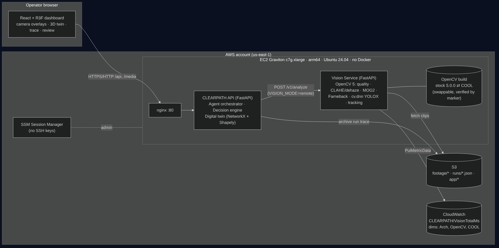
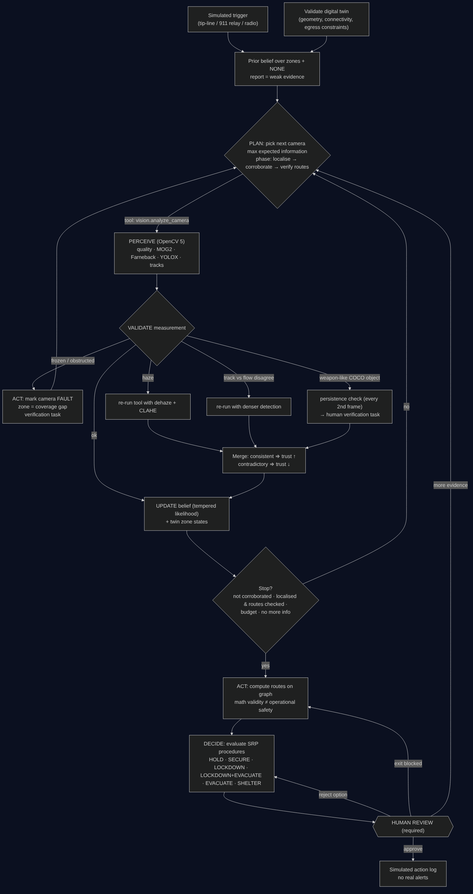

# CLEARPATH — Technical Report

OpenCV AI Competition 2026 (powered by AWS) · Focus path: **Agentic Vision** (COOL: integration prepared, not measured, not claimed)

**Live demo:** http://52.70.58.148 · Graviton proof: http://52.70.58.148/v1/health

## 1. Problem and users

During a reported active threat in a US school, the people who must choose a response — the principal, school resource
officer or district safety lead — face three hard facts: the first report is often wrong or imprecise; camera feeds
are numerous, partially broken and hard to read under stress; and a wrong evacuation order can move students *toward*
danger. Tools that trigger evacuation the moment a "weapon" is detected are dangerous.

CLEARPATH is a decision-support system for **authorised safety personnel**, used in **simulation and training**. It
treats every report as weak evidence, gathers visual evidence actively, quantifies how much it still does not know,
checks whether evacuation routes are actually safe (not just drawable on a floor plan) and hands a recommendation with
its uncertainty to a human, who decides.

## 2. Architecture

* **Vision Service** (`clearpath.vision.service`, FastAPI): stateless OpenCV 5 workload; `/v1/analyze`,
  `/v1/analyze-upload`, `/v1/health` (reports CPU architecture, EC2 instance type via IMDSv2, OpenCV build fingerprint,
  COOL state). Runs in-process during development (`VISION_MODE=local`) or as a separate service on AWS Graviton
  (`VISION_MODE=remote`) — same contract either way.
* **CLEARPATH API** (`clearpath.main`): digital twin, agent orchestrator, decision engine, review endpoints, media.
* **Dashboard** (React/TypeScript/R3F) polls backend state; it holds no metrics of its own.
* **AWS**: Graviton EC2 (arm64, Ubuntu 24.04, systemd + nginx, no Docker), S3 (footage, run archives, app bundle),
  CloudWatch (`CLEARPATH/VisionTotalMs`, `DetectMs`, `FlowMs` with `Arch`, `OpenCV`, `COOL` dimensions), SSM Session
  Manager, least-privilege instance role.

## 3. OpenCV 5 implementation

Per clip (40 frames @10 fps, 768×576) — `backend/clearpath/vision/pipeline.py`:

| Stage | OpenCV | Output used by the agent |
|---|---|---|
| Decode | `VideoCapture` | frames |
| Quality | `cvtColor`, `Laplacian` variance, mean/std, dark channel via `erode`, `absdiff` | brightness, contrast, sharpness, haze, frozen ratio, obstruction ratio → **reliability** ∈ [0,1] and issues |
| Enhancement (on demand) | dark-channel-prior dehaze (`erode`, `GaussianBlur`) + CLAHE in LAB | re-analysis under a different processing condition |
| Foreground | `createBackgroundSubtractorMOG2`, morphology | foreground ratio, mask for flow |
| Dense motion | `calcOpticalFlowFarneback` (half resolution) | foreground-weighted velocity and direction |
| Detection | `cv.dnn.readNet` YOLOX-S (COCO-80), letterbox, grid decode, `dnn.NMSBoxesBatched` | persons (+ weapon-like COCO classes: knife, baseball bat, scissors) |
| Tracking | greedy gated association on foot points | per-track velocity in **body-heights/s** (scale-invariant), running fraction, direction coherence |

Two independent motion estimates (tracked detections vs dense flow) are compared; disagreement makes the agent re-run
with denser detection. Firearms are not a COCO class: CLEARPATH never reports a firearm. An optional dedicated weapon
model can be plugged in (`WEAPON_MODEL`); when absent the capability is reported as unavailable, not simulated.

**Footage.** Real incident footage is neither available nor appropriate. `clearpath/vision/synth.py` uses OpenCV to build
a clean background plate (temporal median) from OpenCV's public sample `vtest.avi`, cuts out **real pedestrian sprites**
(detector box + background-difference mask + connected components) and recomposites them with controlled count,
direction and speed, plus controlled degradations (smoke/haze, lens obstruction, frozen feed). This yields inputs with
known ground truth. The unmodified `vtest.avi` is also evaluated as real footage, and users can upload their own video.

## 4. The agent (perception → decision → action)

* **State**: categorical belief over 16 zones + NONE ("no active threat"); camera states; zone states; routes; options.
* **Prior**: from the simulated report (e.g. confidence 0.5 → P(threat)=0.5, concentrated on the stated zone). A
  report can never localise the threat by itself (localisation requires ≥1 supporting visual observation).
* **Perception → evidence** (`agent/perception.py`): activity ∈ {flight, agitated, calm, congested, empty, unusable}.
  Flight direction is mapped into the building frame with the camera's calibrated `image_right_heading`; the hazard is
  inferred in the opposite direction and spread to zones by bearing alignment and distance.
* **Update**: posterior ∝ prior · LR^r, where r is the *measured* camera reliability, so a frozen or obstructed feed
  moves the belief ~0 and a hazy feed moves it less. P(NONE) is floored at 0.03 (drills, pranks, misread motion).
* **Planning**: three phases chosen from the belief — *localise* (maximise expected information about the threat
  location), *corroborate* (independent camera adjacent to the provisional region), *verify routes* (cameras on
  candidate evacuation corridors outside the exclusion zone). Stop when the report is not corroborated
  (P<0.12 after ≥3 usable views including the reported area), when localised and corridors are checked, when no camera
  adds information, or at the budget.
* **Vision changes the next tool call**: haze → dehaze+CLAHE re-run; track/flow disagreement → denser detection;
  weapon-like object → persistence check at 2× temporal density then a human-verification task (or discard if
  transient); frozen/obstructed → camera FAULT, zone becomes a coverage gap, attention shifts to neighbours. Merged
  results that survive a processing change gain trust; contradictory ones lose it.
* **Action**: routes are computed on the NetworkX graph with the probable region + 1 hop excluded. Each route reports
  *mathematical validity* (connected, avoids exclusion, door widths, configured travel distance) separately from
  *operational safety* (probability-weighted exposure, fraction of transit zones verified by a recent reliable camera,
  congestion, faults). Procedures (Standard Response Protocol vocabulary) are scored with explicit preconditions;
  "why not full evacuation" is always stated.
* **Human control**: every run ends in `awaiting_review`. The reviewer can approve (actions are logged as SIMULATED),
  reject an option (agent re-assesses without it), report an exit blocked (routes recomputed), or request more evidence
  (agent resumes perception with an extra budget). Every step — tool, arguments, result, duration, state diff, reason —
  is in the trace and archived to S3 when configured.

## 5. AWS deployment

`deploy/aws/` provisions one Graviton instance (script default `c7g.xlarge`; deployed on `t4g.small`, see below) with the Vision Service and API as separate
systemd services (`VISION_MODE=remote`), nginx, S3 (private, encrypted), CloudWatch metrics and an instance role
limited to `s3:Get/PutObject` on `app/ footage/ runs/`, `s3:ListBucket` on the bucket, and
`cloudwatch:PutMetricData` restricted to namespace `CLEARPATH`. Evidence that the OpenCV workload runs on Graviton is
produced by the system itself: `/v1/health` (`machine: aarch64`, `instance_type`), per-analysis `service` block shown
in the UI, CloudWatch metrics with `Arch=aarch64`, and archived run JSON in S3. `verify.sh` checks all of these.
**Deployed and verified (2026-10-26).** Provisioned from AWS CloudShell in us-east-1 on a free-plan account, so the
instance is the free-tier Graviton type `t4g.small` (2 vCPU Graviton2, 2 GiB RAM + 4 GiB swap, Ubuntu 24.04 arm64,
OpenCV 5.0.0 `opencv-python-headless` aarch64 wheel). Public endpoint: http://52.70.58.148 (port 80 open for judging; no
SSH, admin via SSM Session Manager). `verify.sh` output:

| Check | Result |
|---|---|
| `/v1/health` runtime | `machine=aarch64`, `graviton=true`, `instance_type=t4g.small` (from IMDSv2), OpenCV 5.0.0, `cool=not_in_use` |
| API → vision | `VISION_MODE=remote`; API has AWS credentials via the instance role |
| Scenario S2 end to end | 6 vision calls, 61.1 s of vision time, 72 s wall time to `awaiting_review`; recommended `LOCKDOWN_PLUS_EVACUATE` (expected); every analysis reports `service.machine=aarch64`; approved → SIMULATED actions only |
| CloudWatch | namespace `CLEARPATH`, `VisionTotalMs` with `Arch=aarch64, OpenCV=5.0.0, COOL=not_in_use`: 6 samples, average ≈ 10.2 s, max ≈ 10.5 s per 40-frame clip |
| S3 | `runs/20261026-075325-f32587.json` (54 KB: full trace, belief, routes, review, timings) |

On this burstable 2-vCPU instance one camera analysis takes about 10 s, against about 4.6 s on the 2-thread x86 dev box.
The deployment scripts accept `--instance-type c7g.xlarge` for a non-burstable 4-vCPU Graviton3 instance on a paid
account; we did not measure it.

## 6. COOL

COOL is integrated as a **swappable OpenCV build** rather than code changes: the pipeline uses standard `cv2` APIs, and
the hot operations named by COOL (resize, adaptive Gaussian threshold, contours) plus the pipeline's actual hot spots
(Farneback, DNN, colour conversion, MOG2) are benchmarked. `runtime_info.cool_status()` reports `verified_marker` only
when a marker unique to the COOL build is present in `cv.getBuildInformation()` or the module path.
`backend/benchmarks/bench_opencv.py` records identity (OpenCV build hash, CPU model, instance type, threads) and timings;
`compare.py` refuses to compare runs from different machines/instance types or an unverified "COOL" run.

Measured so far (stock OpenCV 5.0.0, x86_64 dev box, 2 threads — *not* Graviton): full pipeline 4.6 s per 40-frame clip
(8.6 fps), of which YOLOX ≈ 3.1 s (10 inferences, ~320 ms each) and Farneback ≈ 1.1 s; resize 768×576→384×288
0.25 ms; adaptiveThreshold 1.13 ms; findContours 2.68 ms. **No COOL measurements exist.** Every COOL listing on AWS Marketplace requires a
non-free-tier Graviton family (c6g/m6g/r6g, c8g/m8g/r8g or c9g/m9g), which our free-plan account cannot launch, so we did
not run COOL and do not claim the Best Use of COOL award. The live service reports `cool.state = not_in_use` and
CloudWatch metrics carry `COOL=not_in_use`, so the system never presents stock OpenCV as COOL. The protocol in
`backend/benchmarks/README.md` produces a same-instance stock-vs-COOL comparison when an eligible instance is available.

## 7. Evaluation

From `backend/eval/run_eval.py` (full table in `EVALUATION_RESULTS.md`):

* Perception: 15/15 clips classified correctly against generation ground truth (calm, flight with correct direction,
  empty, congested, frozen, obstructed, haze→dehaze) plus the unmodified real `vtest.avi` (calm).
* Agent: 4/4 expected recommendations; naive "evacuate on weapon report" 0/4.
* Efficiency: S1 stops after 3 of 7 cameras; S2 localises after 2 corroborating cameras then checks corridors only.
* Failure handling: S3 faults 2 cameras, re-runs 1 with dehaze, declines to localise, recommends building-wide lockdown
  and lists verification tasks. S4 shows routes that are mathematically valid but operationally congested.
* Human control: 100% of runs paused for review; approvals produce only SIMULATED log entries (tested).
* Tests: 74 backend (pytest) + 51 frontend (vitest), re-run 2026-10-26.
* On AWS: `verify.sh` passes on the live Graviton instance (section 5). The perception and agent tables above were
  produced on the x86 dev box; the same scenario (S2) reproduced the expected recommendation on Graviton.

## 8. Limitations

* Synthetic footage measures pipeline and agent logic, not field accuracy; thresholds and likelihood ratios are
  hand-set, documented constants and need validation on real, consented, representative data.
* Single-storey fictional layout; no DXF import yet; no exterior cameras (so SECURE is never supported by evidence).
* Belief assumes a single threat location; multiple attackers and moving threats are future work.
* Speed: about 10 s per camera on the free-tier `t4g.small` (about 4.6 s on the x86 dev box), so a scenario takes about
  1 minute. Larger Graviton instances are the intended levers; neither was measured.
* Demo deployment: plain HTTP (no TLS; CloudFront or an ALB with ACM would add it), one shared instance (starting a
  scenario cancels the run in progress), in-progress runs live in memory (completed, reviewed runs are archived to S3).

## 9. Responsible use

Simulation only; no real alerts; no firearm-detection claims; human approval for every consequential option; explicit
uncertainty and coverage gaps; no biometric identification (people are counted and tracked anonymously within a clip
only); no real incident imagery; credentials never in source (boto3 default chain, instance role, IMDSv2 required).
