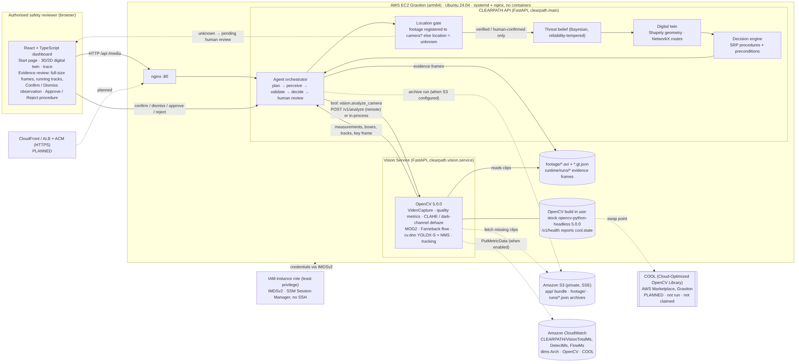

# CLEARPATH: Technical Report

OpenCV AI Competition 2026 (powered by AWS). Focus path: **Agentic Vision**. COOL: a swap point and a benchmark
harness are prepared, but nothing has been measured, so the COOL award is not claimed.

Status labels used below:

* **Verified**: run and checked in this repository, with the evidence named.
* **Implemented**: the code exists and is tested, but it has not been run in the stated environment.
* **Planned**: not built.
* **Reported**: stated by the team; not re-verified for the current code.

> **SIMULATION ONLY.** The footage is synthetic, recomposited from OpenCV's public sample video `vtest.avi`. Triggers
> are simulated reports. No code path can send a real alert, notification or door command. CLEARPATH has **no firearm
> detector**.

## 1. Problem and users

When an active threat is reported at a school, the people who choose the response must decide quickly with poor
information. Examples are a principal, a school resource officer or a district safety lead. They face three problems:

* First reports are often wrong or imprecise.
* Camera feeds are numerous, partly broken and hard to read under stress.
* An evacuation order can move students *toward* danger.

A system that triggers evacuation on a "weapon detected" alert is unsafe.

CLEARPATH is **decision support for authorised safety staff, for simulation and training**. It treats a report as
weak evidence and gathers visual evidence actively. It also checks whether evidence is actually tied to a known place.
It separates a route that exists on the floor plan from a route that has been verified safe. Every consequential step
goes to a human.

**Target users:**

* school safety leads and SROs, rehearsing response procedures;
* district emergency planners, evaluating camera coverage and failure modes;
* researchers, studying human-in-the-loop vision agents.

## 2. Architecture

Source: [`architecture.mmd`](architecture.mmd). Agent workflow: [`diagrams/agent_workflow.png`](diagrams/agent_workflow.png).

| Component | Code | Status |
|---|---|---|
| Vision Service: stateless OpenCV 5 workload (`/v1/analyze`, `/v1/analyze-upload`, `/v1/health`) | `backend/clearpath/vision/` | Verified locally (tests and evaluation) |
| API: agent orchestrator, location gate, belief, digital twin, decision engine, review endpoints | `backend/clearpath/main.py`, `agent/`, `decision/`, `twin/` | Verified locally |
| Web UI: start page, 3D/2D twin, evidence review, trace, history | `frontend/src/` | Verified locally (vitest, production build, browser walk-through with Playwright) |
| AWS kit: Graviton EC2, S3, CloudWatch, IAM role, SSM, nginx, systemd | `deploy/aws/` | Implemented. A live deployment of commit `a3e70d5` was **reported** on 2026-10-26. The current code is **not deployed**. |
| COOL build swap and stock-vs-COOL benchmark | `backend/benchmarks/`, `vision/runtime_info.py` | Implemented harness. COOL itself **not run**. |
| HTTPS (CloudFront / ALB + ACM) | — | Planned |

The vision service runs in-process during development (`VISION_MODE=local`). On AWS it runs as a separate service over
HTTP (`VISION_MODE=remote`). The contract is the same either way. The UI holds no metrics of its own: everything shown
comes from backend run state.

## 3. OpenCV 5 implementation

The pipeline is `backend/clearpath/vision/pipeline.py`. It processes 40 frames per clip at 10 fps and 768×576.

| Stage | OpenCV 5 APIs | What the agent uses |
|---|---|---|
| Decode | `VideoCapture` | frames |
| Image quality | `cvtColor`, `Laplacian` variance, mean/std, dark channel via `erode`, `absdiff` | brightness, contrast, sharpness, haze, frozen and obstruction ratios. Together these give a **reliability** in [0, 1] plus a list of issues. |
| Enhancement (on demand) | dark-channel-prior dehaze (`erode`, `GaussianBlur`), CLAHE in LAB | a re-analysis under different processing |
| Foreground | `createBackgroundSubtractorMOG2`, morphology | foreground ratio, and a mask for the flow stage |
| Dense motion | `calcOpticalFlowFarneback` | foreground-weighted direction and speed |
| Detection | `dnn.readNet` YOLOX-S (OpenCV Model Zoo, COCO-80), letterbox, grid decode, `dnn.NMSBoxesBatched` | persons. Weapon-like COCO classes (knife, bat, scissors) are only ever labelled "weapon-like". |
| Tracking | gated association on foot points | per-track speed in **body-heights/s**, running flags, direction coherence, a **key frame** |
| Evidence | `imencode` at native resolution, JPEG q88 | the frames the reviewer inspects, with real boxes |

Two independent motion estimates, from the tracks and from dense flow, are cross-checked. If they disagree, the agent
re-runs the analysis with denser detection.

**Firearms are not a COCO class.** CLEARPATH never reports a firearm. A dedicated model can be plugged in with
`WEAPON_MODEL`. Without one, the UI says *"No firearm detector is configured"* rather than simulating the capability.

## 4. Agent (perception → decision → action, with human control)

* **Prior:** set from the simulated report. A report alone can never localise a threat.
* **Location gate** (`agent/location.py`): an observation's location is the camera's zone *only* when the footage is
  registered as recorded by that camera. Otherwise the location is **unknown**. The observation is kept and shown, but
  it is not applied to the belief, zone alerts, routes or twin until a reviewer confirms it.
  * This fixed a real bug. Outdoor sample footage replayed on indoor cameras had produced a 93 % "threat zone" inside
    the building. See `bug-fix-and-validation-report.md`.
* **Belief update:** the posterior is proportional to prior × LR^reliability, so frozen or obstructed feeds move the
  belief by about zero. P(no threat) has a floor of 0.03.
* **Vision changes the next tool call:**
  * haze → dehaze plus CLAHE re-run;
  * track and flow disagreement → denser detection;
  * weapon-like object → persistence check, then a human verification task;
  * frozen or obstructed feed → camera fault and a coverage gap.
  * The camera to analyse next is chosen by expected information.
* **Action:**
  * Routes are computed on the twin graph with the probable region plus one hop excluded. *Mathematical validity* is
    reported separately from *operational safety*.
  * Standard Response Protocol procedures are scored against explicit preconditions.
  * If the reviewer rejects the only feasible option, the agent says so (`no_feasible_alternative`) instead of quietly
    proposing it again.
* **Human control:** every run pauses at `awaiting_review`. The reviewer can:
  * **confirm** or **dismiss** each observation (a dismissal needs a reason, and the evidence is kept);
  * **approve** (actions are logged as `SIMULATED` only) or **reject** a procedure;
  * report an exit as blocked;
  * request more evidence.

  Every decision is recorded in the trace and the review history. A UI success message appears only after the backend
  accepts the decision.
* **Observability:** each trace step records the tool, arguments, result, duration, state diff and the reason it was
  taken. Runs are archived to S3 when a bucket is configured.

## 5. AWS deployment

`deploy/aws/` provisions one Ubuntu 24.04 **arm64** instance on Graviton with:

* nginx;
* the API and the vision service as two systemd units (`VISION_MODE=remote`), with no containers;
* a private, encrypted S3 bucket (app bundle, `footage/`, `runs/`);
* CloudWatch custom metrics (`CLEARPATH/VisionTotalMs`, `DetectMs`, `FlowMs`, with `Arch`, `OpenCV` and `COOL`
  dimensions);
* a least-privilege instance role: S3 Get/Put limited to three prefixes, and `PutMetricData` limited to the
  `CLEARPATH` namespace;
* IMDSv2 and SSM Session Manager (no SSH);
* a security group allowing port 80 from the operator's /32 only, or from anywhere with `--public` for judging.

Footage is generated on first boot. `verify.sh` checks:

* the `aarch64` instance type via `/v1/health`;
* that the API uses the remote vision service;
* a scenario S2 run, including a human confirmation step;
* CloudWatch datapoints with `Arch=aarch64`;
* the S3 run archive.

**Status:**

* **Reported (not re-verified):** on 2026-10-26 the team ran `verify.sh` against `t4g.small` at `52.70.58.148` for
  commit `a3e70d5`, with every check passing and about 10.2 s per clip.
* **Not reachable from here:** we could not reach that endpoint from this evaluation environment (network allowlist).
* **Current code not deployed:** the current code has not been deployed. Redeploying and re-running `verify.sh` is
  required before claiming the current version runs on AWS.

## 6. COOL

The pipeline uses standard `cv2` APIs, so COOL would be a build swap with no code changes:

* `runtime_info.cool_status()` reports `verified_marker` only when a marker unique to the COOL build is found.
* `backend/benchmarks/bench_opencv.py` records the build fingerprint, CPU, instance type and timings.
* `compare.py` refuses to compare runs from mismatched machines, or any run labelled "COOL" that is not verified.

**No COOL measurement exists.** The live system reports `cool.state = not_in_use`. We do not claim Best Use of COOL.

## 7. Evaluation

Full methodology and failure cases are in [`../evaluation/README.md`](../evaluation/README.md). All results below were
measured on x86_64, 2 vCPU, OpenCV 5.0.0.

| Measure | Result |
|---|---|
| Activity classification vs generation labels | 15/15 clips, including the unmodified `vtest.avi` |
| Person detection, clean frames, IoU 0.5 | P 0.970 / R 0.932 (synthetic sprites, optimistic: they were extracted with the same detector) |
| Running-track classification | P 0.967 / R 0.829 over 91 matched tracks |
| False candidate events | 0 of 10 non-flight clips; 4 of 4 flight clips flagged |
| Observations given a zone before review (unregistered footage) | 0 of 26 |
| Human-review state invariants | 160/160 |
| Recommendations | before review, 4/4 report-only LOCKDOWN; after confirmations, 4/4 expected; naive "evacuate on weapon report" 0/4 |
| Pipeline time per 40-frame clip | ≈ 7.0–7.4 s median across two runs (YOLOX forward ≈ 0.5 s median) |
| Tests | backend pytest and frontend vitest all passing (counts in `testing.md`) |

**Pending (not measured):**

* real-footage accuracy;
* firearm detection;
* physical event-location accuracy;
* Graviton latency for the current code;
* COOL vs stock OpenCV;
* operator usability.

## 8. Limitations

* **Synthetic data:** synthetic composites measure the pipeline and the agent logic, not field accuracy. Thresholds
  such as running > 2.0 BH/s and the likelihood ratios are hand-set, documented constants.
* **No calibrated site footage:** no footage is registered to a camera, so every location needs human confirmation.
  A confirmation is an assertion by the reviewer, not a measurement.
* **Twin scope:**
  * single-storey fictional school;
  * single-threat belief;
  * no exterior cameras, so SECURE is never supported by evidence;
  * no DXF import.
* **Speed:** a scenario analyses 7 cameras before the first review, which takes about 50 s on 2 x86 vCPUs.
* **Demo hosting:** plain HTTP, one shared instance (starting a run cancels the active one), and in-progress run state
  held in memory.
* **Occlusion and tracking:** crowd occlusion lowers detection (congested clip R 0.82), and fast movers can produce
  fragmented tracks.

## 9. Security, privacy and responsible use

* **Simulation only:**
  * no real alerts or actuation;
  * approved actions are written as `SIMULATED` lines;
  * the README and UI say so on every screen.
* **No surveillance identity:**
  * no face recognition, biometrics or re-identification;
  * people are counted and tracked anonymously within a 4-second clip only;
  * no student or school imagery is used. The only footage is OpenCV's public sample.
* **No overclaiming:**
  * no firearm detection;
  * unknown locations are shown as unknown;
  * dismissing an observation is labelled as not affecting the real world;
  * unmeasured metrics are marked Pending.
* **Credentials:**
  * none in source;
  * boto3 uses its default chain or the instance role via IMDSv2;
  * provisioning refuses the AWS root user;
  * the S3 bucket blocks public access and uses SSE-S3.
* **Real-world use would require:**
  * consented and representative data;
  * a privacy impact assessment;
  * retention limits for footage and run archives;
  * authentication and roles in front of the review actions (there is no login in this demo);
  * TLS;
  * validation with trained safety staff.
